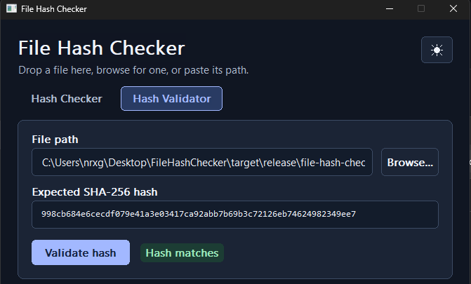

# File Hash Checker

A simple lightweight program written in rust that allows you to see the SHA256HASH of a .exe file and then check if the hash matches the .exe or not
reason for this project is cuz each time I wanna create a hash file or check it I don't wanna write the command into powershell

[](LICENSE)

## Features

- Fast,Lightweight
- Simple to use

## Screenshots



## Installation

Requires RustLang installed to build

```Rust
git clone https://github.com/username/repository.git
cd FileHashChecker
cargo build --release
```

## License

[MIT](LICENSE)
